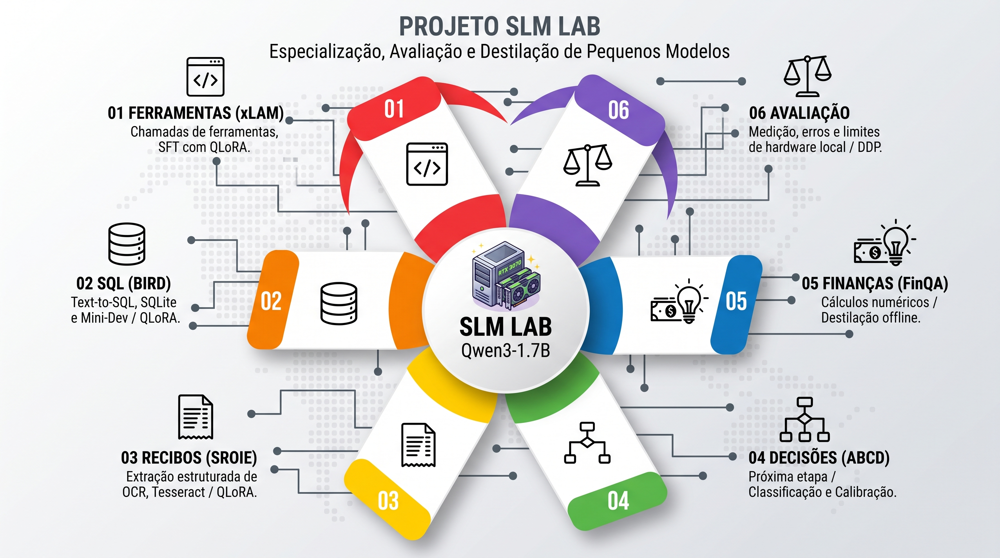

# SLM Lab: especialização, avaliação e destilação de pequenos modelos



Este projeto reúne **cinco laboratórios para uma aula sobre o uso de pequenos modelos de linguagem (SLMs)**. Partimos de modelos pré-treinados, especializamos tarefas e medimos o que mudou em relação ao modelo original e a uma referência de comparação.

A base dos especialistas é o **Qwen3-1.7B**, ajustado com **QLoRA**. O quinto laboratório acrescenta um **Qwen3-8B como professor**, gerando supervisão para destilação offline. Os roteiros foram preparados para Ubuntu, Python 3.11/3.12 e duas RTX 3070 de 8 GB, com um único ambiente virtual.

A proposta é experimentar com problemas concretos, resultados verificáveis e limites explícitos. Ganhos de qualidade, velocidade ou custo são hipóteses a medir, não garantias de que um SLM sempre vencerá um modelo maior.

## Os cinco laboratórios

| Lab | Tarefa e dataset | Entrada → saída | Método |
|---|---|---|---|
| [01: Ferramentas](laboratorio-01-slm-ferramentas-xlam.md) | Chamadas de ferramentas / xLAM | Solicitação e catálogo → JSON com nomes e argumentos | Fine-tuning supervisionado com QLoRA |
| [02: SQL](laboratorio-02-slm-sql-bird.md) | Text-to-SQL / BIRD e Mini-Dev | Pergunta, esquema e evidence → SQL e resultado de execução | Fine-tuning supervisionado com QLoRA |
| [03: Recibos](laboratorio-03-slm-extracao-recibos.md) | Extração estruturada / SROIE | Texto de OCR → company, date, address e total | Fine-tuning supervisionado com QLoRA |
| [04: Decisões](laboratorio-04-slm-decisoes-abcd.md) | Próxima etapa de atendimento / ABCD | Histórico e regras → classe, probabilidades e indicação de revisão | QLoRA com camada de classificação; calibração posterior |
| [05: Finanças](laboratorio-05-slm-financeiro-finqa.md) | Perguntas numéricas / FinQA | Textos, tabela e pergunta → evidências, programa e cálculo executado | SFT convencional versus destilação offline com QLoRA |

Os artefatos são específicos de cada tarefa. Não são cinco arquiteturas novas nem cinco modelos pré-treinados do zero. Usamos uma base comum de 1,7B com adaptações separadas; no Lab 05, produzimos dois adaptadores do aluno para comparar as formas de supervisão.

## Treino, fine-tuning, quantização e destilação

| Conceito | O que significa | Como aparece no projeto |
|---|---|---|
| **Pré-treinamento do zero** | Aprender os pesos iniciais a partir de grandes corpora | **Não fazemos.** Os pesos iniciais vêm dos modelos Qwen publicados. |
| **Treinamento** | Otimizar parâmetros usando exemplos e uma função de perda | Fazemos treinamento dos adaptadores e, no Lab 04, da camada de classificação. |
| **Fine-tuning / ajuste fino** | Continuar a adaptação de um modelo já pré-treinado para uma tarefa | É o mecanismo dos especialistas dos cinco labs. |
| **SFT / fine-tuning supervisionado** | Aprender a partir de entradas e alvos de referência | SFT de texto nos Labs 01 a 03 e na condição convencional do Lab 05; no Lab 04, fine-tuning supervisionado de um classificador. |
| **LoRA** | Aprender adaptadores menores enquanto os pesos da base permanecem congelados | Produz os adaptadores específicos das tarefas. |
| **QLoRA** | Ajustar adaptadores sobre uma base quantizada em 4 bits | Reduz a memória necessária para os treinos locais. Não é treinamento completo de todos os pesos da base. |
| **Quantização** | Representar pesos com menor precisão numérica | Usamos NF4 de 4 bits com bitsandbytes. É diferente de destilação e, sozinha, não ensina uma nova tarefa. |
| **Destilação** | Transferir comportamento de um professor para um aluno usando sua supervisão | **Lab 05:** o Qwen3-8B produz respostas aprovadas para ensinar o Qwen3-1.7B. |
| **Inferência** | Aplicar o modelo a uma nova entrada | Gera chamadas, SQL, campos, classes ou programas, sem atualizar pesos. |
| **Recuperação de contexto** | Selecionar informações para incluir na entrada | O Lab 04 recupera regras e o Lab 05 seleciona fontes com TF-IDF. Isso não grava essas informações nos pesos. |
| **Calibração** | Ajustar a interpretação de probabilidades após o treinamento | No Lab 04, temperatura e limiar ajudam a decidir quando indicar revisão. Não são uma nova destilação. |

**Fine-tuning e destilação podem coexistir.** No Lab 05, usamos fine-tuning com QLoRA para o aluno aprender as respostas produzidas pelo professor. A diferença experimental está na origem da supervisão: gabaritos originais versus respostas verificadas do professor.

Comparar um SLM com uma API, ou executar um modelo quantizado, **não é destilação**. Nos Labs 01 a 04, a referência maior serve para avaliação; suas respostas de teste não entram no treinamento.

Uma descrição precisa para a aula é:

> “Especializamos um pequeno modelo pré-treinado em cinco tarefas. Nos quatro primeiros laboratórios usamos fine-tuning supervisionado. No quinto, comparamos esse ajuste com destilação offline de um professor maior, usando os mesmos exemplos de treino.”

Os cinco laboratórios tiveram treinamento e testes concluídos. No Lab 05, o aluno destilado melhorou sobre o modelo original, mas ficou abaixo do SFT convencional no teste completo; a execução não demonstrou ganho adicional da destilação sobre os gabaritos.

## O que fazemos em cada laboratório

### 01: propor chamadas de ferramentas

O modelo recebe a solicitação do usuário e um catálogo de funções. Aprende a selecionar funções e preencher argumentos, retornando um array JSON. A avaliação verifica nomes, quantidade de chamadas e argumentos, além de formato e ferramentas inventadas.

O laboratório **propõe chamadas**. A aplicação consumidora deve validar autorização, argumentos e efeitos antes de executá-las. A comparação por API usa o mesmo contrato textual; não ativa o tool calling nativo do provedor. Esse mecanismo pode ser avaliado separadamente, com outro cliente e protocolo.

### 02: gerar e conferir SQL

O modelo recebe uma pergunta, o esquema SQLite e pistas disponíveis, gera SQL e tem seu resultado comparado ao SQL de referência. O treino e a validação usam o BIRD filtrado; o teste usa 500 perguntas do Mini-Dev.

O executor bloqueia escrita, extensões, `ATTACH` e alterações de PRAGMA, com limites de tempo e linhas. EX-set compara conjuntos de linhas; EX-bag também considera duplicatas. Essas métricas locais não verificam ordenação nem substituem o score oficial BIRD.

O modelo não incorpora automaticamente os dados atuais do banco nos pesos. O esquema é fornecido na inferência. O experimento SQLite não valida transferência para PostgreSQL ou outros dialetos.

### 03: interpretar o texto de recibos

Tesseract produz o OCR, e o SLM extrai quatro campos: empresa, data, endereço e total. O roteiro inclui extração local e exportação estruturada, com investigação dos erros de OCR e do modelo.

Treinamos **o modelo de texto**, não o Tesseract nem um modelo de visão. O dataset contém recibos em inglês; os resultados não validam automaticamente documentos fiscais brasileiros, CNPJ, impostos ou layouts novos.

### 04: classificar a próxima etapa

Uma camada de classificação sobre o Qwen recebe o histórico de atendimento e regras recuperadas. O catálogo tem **31 classes**, incluindo `retrieve_utterance`. O treinamento ajusta os adaptadores e a camada de saída; depois, a calibração ajusta a temperatura e seleciona um limiar de revisão.

A API devolve escolha, probabilidades, confiança calibrada e `requires_review`. Ela não executa a ação nem gera automaticamente uma resposta final ao cliente. Na interface web, as mensagens e ações posteriores dos exemplos ABCD aparecem como **registros do dataset**, separados da recomendação e fora do prompt.

O catálogo é fixo. Acrescentar classes exige adaptar e treinar a saída. A inspiração de interface “Jev-like” não significa reproduzir a arquitetura, treinamento ou resultados do Jev.

### 05: destilar cálculos financeiros verificáveis

O professor **Qwen3-8B** recebe somente contexto e pergunta de candidatos do treino. Propõe fontes e um programa de cálculo. Um validador confere formato, operações, origem dos operandos e resultado contra `exe_ans`; uma amostra é disponibilizada para revisão humana.

As respostas aprovadas produzem dois conjuntos com **os mesmos IDs e prompts**:

- **Aluno SFT:** aprende os programas e evidências originais do FinQA.
- **Aluno destilado:** aprende os programas e evidências aprovados do professor.

Professor e aluno são executados em fases separadas. Durante o treinamento do aluno, o professor está descarregado. A modalidade é **destilação de sequências offline**, sem perda entre logits ou acesso ao raciocínio interno do professor.

A comparação inclui aluno original, aluno SFT, aluno destilado e professor, no mesmo teste completo. O executor calcula resultados e mostra etapas e evidências. Uma resposta numericamente correta pode resultar de uma interpretação incorreta; a verificação automática não dispensa a revisão do procedimento, das unidades e das anotações.

O laboratório começa com tabelas/textos estruturados. Não extrai PDFs automaticamente nem oferece aconselhamento financeiro. O efeito da destilação deve ser medido: ele pode ser positivo, nulo ou negativo em relação ao SFT convencional.

## Resultados registrados e estado das integrações

O repositório contém treinamento e avaliação completos dos **cinco laboratórios**, com métricas registradas e integrações no avaliador. Cada API de inferência precisa estar ativa para novos testes com os adaptadores.

| Laboratório | Medidas registradas | Inferência web |
|---|---|---|
| 01 | Treino e teste completos: especialista 81,30%, base 62,89%, API 75,32% | Benchmark em CPU e adaptador real opcional no avaliador |
| 02 | Treino e teste completos, com métricas e consumo registrados | Integrado ao avaliador quando a API SQL está ativa |
| 03 | Teste completo: especialista 24,65%, base 6,09%, API 7,48%; quatro campos corretos por recibo | OCR/benchmark em CPU e adaptador real opcional no avaliador |
| 04 | Treino e teste completos, com calibração e comparação registradas | Integrado ao avaliador quando a API de decisões está ativa |
| 05 | Teste completo: SFT 45,16%, destilado 42,55%, professor 19,44%, base 2,27%; 1.147 exemplos | Benchmark dos quatro modelos em CPU e aluno destilado real opcional |

Duas comparações ilustram por que precisamos medir:

| Condição | Lab 02: EX-set em 447 casos elegíveis/válidos | Lab 04: acurácia em 13.152 decisões |
|---|---:|---:|
| Qwen original | 14,54% | 65,13% |
| SLM ajustado | 25,50% | 85,45% |
| Referência `gpt-4.1-mini` | 51,45% | 55,37% |

No SQL, o ajuste melhorou a base, mas a referência por API manteve vantagem. Nas decisões, o especialista teve maior acurácia nessa configuração. **Não compare diretamente os percentuais entre laboratórios:** são tarefas, métricas e conjuntos diferentes.

No Lab 02, há 500 perguntas totais, 51 fora do contexto e duas referências que excederam o timeout, deixando 447 casos na comparação principal. No Lab 04, a acurácia somente nos turnos de ação do especialista é **64,33%**; a acurácia global inclui também os turnos de fala. Cobertura, erro após seleção, macro-F1, latência, intervalos e limitações estão nos respectivos roteiros.

No Lab 05, reproduzir o resultado dos programas originais com um executor **não é medir a acurácia de um modelo**. A auditoria CPU valida o cálculo de referência; o ganho de destilação só pode ser avaliado depois da geração e dos treinos.

## O que o projeto não faz

- **Não pré-treina modelos do zero**, cria arquiteturas próprias ou demonstra cinco modelos gerais independentes. Cada especialização usa uma base pré-treinada e artefatos específicos.
- **Não promete superar modelos maiores** em todas as tarefas, nem transfere conclusões de um laboratório para outro.
- **Não torna o SLM um agente autônomo completo.** Propor uma ferramenta ou próxima ação não implementa planejamento geral, autorização ou execução de um fluxo empresarial.
- **Não usa respostas de teste para treinar ou destilar.** Validação orienta as escolhas; o teste mede a configuração congelada.
- **Não garante ausência de contaminação de benchmarks públicos** no pré-treinamento dos modelos de origem.
- **Não transforma quantização em destilação.** Reduzir a precisão dos pesos e transferir supervisão de um professor são processos diferentes.
- **Não treina OCR ou visão no Lab 03**, nem valida automaticamente recibos de outros países e domínios.
- **Não valida consultas para produção**, outros dialetos SQL ou autorização sobre bancos empresariais. O executor SQLite é uma restrição local de laboratório, não isolamento completo de processo.
- **Não garante que uma confiança alta ou um cálculo executável estejam corretos.** Calibração, verificações e fontes ajudam a avaliar; não substituem todos os controles da aplicação.
- **Não oferece aconselhamento financeiro**, integração completa com InfiniteStack ou extração universal de relatórios PDF.
- **Não publica pesos treinados ou datasets como parte do checkout.** Os roteiros obtêm dados/modelos externos e produzem os artefatos nas pastas de trabalho.
- **Não considera custo local igual a zero.** Energia, hardware, geração do professor, treinamento e operação precisam entrar nas estimativas.

## Como começar

O clone abaixo baixa os roteiros e o código do projeto. Datasets, pesos de base e adaptadores treinados não vêm no clone; cada roteiro explica seus downloads e a finalidade dos arquivos externos.

```bash
git clone https://github.com/damico/slm-lab.git
cd slm-lab
```

1. Execute a [preparação geral](preparacao-geral.md) para criar o venv compartilhado em `~/slm-labs/.venv` e instalar o [requirements.txt](requirements.txt).
2. Escolha o laboratório e mantenha scripts, dados e artefatos na sua pasta de trabalho. Alguns scripts têm nomes iguais entre labs e precisam permanecer separados.
3. Faça os testes curtos de memória e funcionamento antes do treino longo. Encerre APIs que estejam ocupando as GPUs.
4. Ajuste as escolhas na validação, preserve revisões/hashes e execute as condições no mesmo teste.
5. Use o [avaliador web](avaliador/README.md) para as integrações disponíveis. O frontend é Spring Boot + Thymeleaf + Bootstrap local; as APIs Python carregam os adaptadores reais.

Cada roteiro possui um `.sh` correspondente, com etapas selecionáveis e logs separados. Use `--list` antes de escolher `--steps`. Servidores e monitores ficam em primeiro plano, e a revisão da supervisão do Lab 05 ocorre antes dos treinos. Os caminhos de exemplo consideram um checkout em `~/git/slm-lab`; ajuste-os se usar outro local.

**Duas GPUs de 8 GB não viram automaticamente uma GPU de 16 GB.** O treino DDP replica o aluno por placa. No Lab 05, a inferência do professor pode distribuir camadas entre as duas placas; ela ocorre separadamente do treino. As APIs mantêm pesos na VRAM mesmo ociosas e devem ser encerradas antes de treinar.

## Explorar os dados na interface

O [avaliador](avaliador/README.md#explorar-os-datasets-dos-cinco-laboratórios) tem uma área **Explorar datasets** em `/datasets`, com acesso aos cinco laboratórios, busca, filtros por conjunto, exemplos aleatórios e gabaritos que podem ser revelados. Cada tarefa tem um leitor próprio, incluindo imagem de recibo e tabelas financeiras. A exploração não carrega modelos nem usa GPU.

Os dados preparados são a versão padrão. Para labs ainda não preparados, é possível importar fontes originais, explicitamente identificadas, sem executar OCR ou treino. Explorar um gabarito serve para estudo; ele continua fora da entrada da avaliação dos modelos.

## Organização do repositório

| Caminho | Conteúdo |
|---|---|
| `preparacao-geral.md` e `requirements.txt` | Ambiente único e dependências fixadas |
| `laboratorio-*.md` | Objetivos, procedimentos, medidas e limites dos cinco labs |
| `laboratorio-*.sh` | Comandos extraídos dos roteiros, divididos em etapas |
| `scripts/lab01-ferramentas/` | Preparação xLAM, treino, inferência e avaliação de chamadas |
| `scripts/lab02-sql/` | Preparação BIRD, treino, execução de consultas e API SQL |
| `scripts/lab03-recibos/` | OCR, preparação, treino e avaliação da extração |
| `scripts/lab04-decisoes/` | Preparação ABCD, classificação, calibração e API |
| `scripts/lab05-finqa/` | Recuperação, executor, professor, pares SFT/destilados, avaliação e API |
| `avaliador/` | Interface web, documentação e resultados preservados das execuções medidas |
| `diagramas/` | Fluxos dos laboratórios |
| `tests/lab05/` e `avaliador/tests/` | Testes das regras e integrações Python |

Os adaptadores `final_adapter` não são modelos completos independentes: carregam-se com a base/revisão correspondente. O Lab 04 também requer seu catálogo e arquivo de calibração. Preserve prompts, dados, versões, relatórios, logits/predições pertinentes e logs para que as medidas possam ser conferidas.

As licenças e condições dos datasets/modelos são próprias de cada fonte. Consulte os respectivos roteiros antes de redistribuir dados ou artefatos; a licença de um dataset não se estende automaticamente a todos os componentes do projeto.

## Referências conceituais

- [QLoRA: Efficient Finetuning of Quantized LLMs](https://arxiv.org/abs/2305.14314).
- [Sequence-Level Knowledge Distillation](https://arxiv.org/abs/1606.07947).
- [FinQA: A Dataset of Numerical Reasoning over Financial Data](https://arxiv.org/abs/2109.00122).

As fontes específicas, revisões e convenções de avaliação estão documentadas em cada laboratório. A apresentação deve distinguir **o desenho do experimento**, **a implementação verificada** e **os resultados efetivamente medidos**.


## Resultado final do Lab 05

Em 15/10/2026, os quatro modelos foram avaliados nos mesmos 1.147 exemplos FinQA: original **2,27%**, SFT convencional **45,16%**, aluno destilado **42,55%** e professor **19,44%** de acerto completo pela métrica local de execução. A destilação ficou abaixo do SFT nesta execução. Tempos, VRAM, cobertura, intervalos e limites estão no [roteiro](laboratorio-05-slm-financeiro-finqa.md). Os cinco laboratórios estão integrados ao [avaliador web](avaliador/README.md), incluindo programas, resultados e evidências do FinQA.
